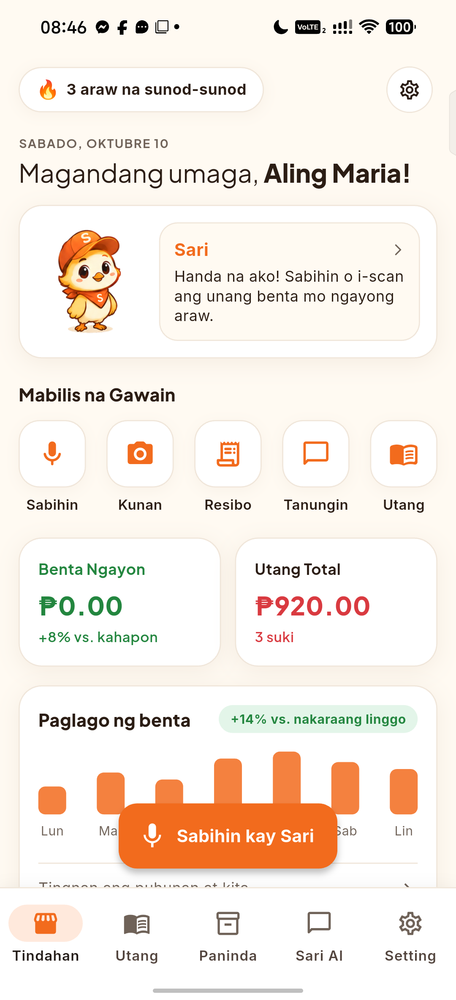
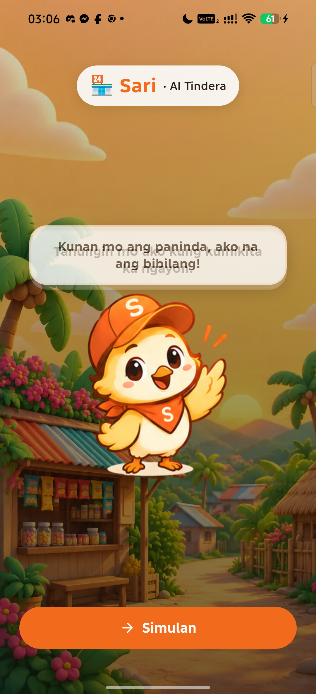
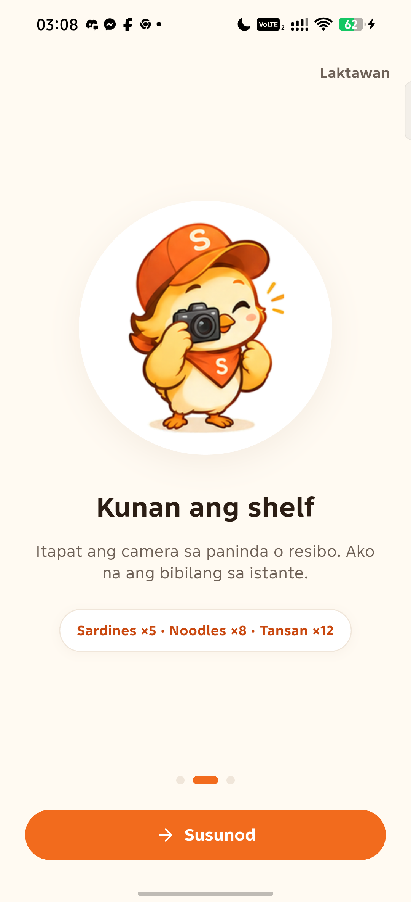
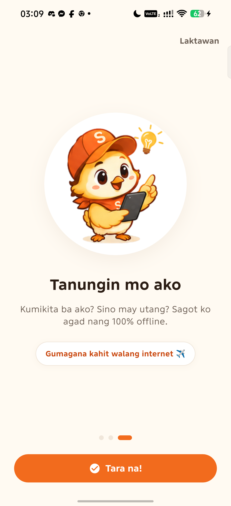

# 🏆 AppBuildersPH Hackathon 2026 — Official Submission

**Theme:** Local AI  
**Track:** Consumer App / Micro-Retail & Financial Inclusion  
**Submission Deadline:** 10:00 AM, October 10, 2026  

---

## 📋 Submission Checklist Quick Reference

| Category | Item | Submission Detail / Status |
| :--- | :--- | :--- |
| **The Project** | **Project Name** | **Sari** — The Sari-Sari Business Brain |
| | **Short Description** | 100% offline, voice-first AI assistant and smart ledger empowering Philippine sari-sari store owners to track sales, manage *utang*, count inventory, and plan restocks with zero cloud dependencies. |
| | **Team Members** | **James Fontanilla** ([@jamesfontanilla](https://github.com/jamesfontanilla)) — Lead Developer<br>**Melfred Bernabe** ([@caramel-123](https://github.com/caramel-123)) — Lead Designer |
| | **Public GitHub Repository** | [https://github.com/jamesfontanilla/Sari](https://github.com/jamesfontanilla/Sari) |
| **The Proof** | **Pre-built Demo APK** | [**Download Sari APK on Google Drive**](https://drive.google.com/file/d/1Lk5Ypf8L4ZXcOElyQK6olnAms0Qyli1w/view?usp=sharing) |
| | **Demo Video** | *[Insert Demo Video Link Here — e.g., YouTube / Google Drive / Loom / MP4]* |
| | **X / LinkedIn Video URL** | *[Insert X / LinkedIn Video Post URL Here]* |
| | **What Runs Locally** | 100% of speech recognition, Tagalog NLP parsing, text-to-speech synthesis, barcode scanning, LLM reasoning, SQLite queries, and business telemetry. |
| | **What Requires Internet** | **0% (Absolutely Nothing).** Works completely in Airplane Mode with SIM/Wi-Fi disabled. |
| **The Disclosures** | **Models Used** | Llama 3.2 3B Instruct (GGUF), Whisper Base (STT), Google ML Kit Barcode Vision (on-device), Android Native TTS Engine (`fil-PH`). |
| | **Technologies & Frameworks** | Flutter 3.24+, Dart, SQLite (`sqflite`), Android NDK (ARM64), `flutter_tts`, `mobile_scanner`, `audioplayers`, `shared_preferences`. |
| | **APIs & Cloud Services** | **None (0).** Zero external API keys, zero cloud endpoints, zero remote telemetry. |
| | **Existing Code & Assets** | Custom Sari mascot animations & illustrations (`assets/sari/`), 20 pre-seeded authentic Philippine FMCG barcodes, standard open-source Flutter plugins. |
| | **AI Development Tools** | Antigravity, Cursor, Claude 3.7 Sonnet, Gemini Code Assist (used for code pairing & rapid UI iteration). |

---

## 🌟 1. The Project

### Project Name
**Sari** — The Sari-Sari Business Brain  
*(Kilalanin si Sari: Ang Matalinong Katulong ng Tindahang Pilipino)*

### Short Description
**Sari** transforms any low-cost Android phone into an intelligent, voice-driven **Point-of-Sale (POS), inventory tracker, and business brain** tailored specifically for the 1.3 million Philippine *sari-sari* store owners (*Aling Maria*). Operating **100% offline in Airplane Mode**, Sari speaks and understands natural colloquial Filipino/Taglish, keeping small store owners in total control of their livelihood with **zero cloud dependencies, zero data costs, and complete financial privacy**.

### Team Members
- **James Fontanilla** — Lead Developer ([GitHub: @jamesfontanilla](https://github.com/jamesfontanilla))
- **Melfred Bernabe** ([caramel-123](https://github.com/caramel-123)) — Lead Designer

### Public GitHub Repository
- **Repository URL:** [https://github.com/jamesfontanilla/Sari](https://github.com/jamesfontanilla/Sari)
- **Primary Branch:** `main`
- **License:** MIT License

---

## 🎥 2. The Proof

### Pre-built Demo APK (Quick Install for Evaluators)
- **Direct Download Link:** **[Download Sari Demo APK on Google Drive](https://drive.google.com/file/d/1Lk5Ypf8L4ZXcOElyQK6olnAms0Qyli1w/view?usp=sharing)**
- **Architecture:** Android ARM64 (API 29+)
- **Verification Note:** Can be installed directly on any physical Android device. Once installed, activate **Airplane Mode** to verify 100% offline functionality.

### Demo Video
- **Link:** *[Insert Demo Video Link Here — e.g., YouTube / Google Drive / Loom]*
- **Video Highlights Covered in Demo:**
  1. **Airplane Mode Activation:** Demonstrating phone disconnected from Wi-Fi and Cellular Data.
  2. **0ms Voice Bookkeeping:** Recording transactions (*"Si Mang Juan utang 150 sardinas"*, *"Nagbayad si Aling Rosa ng 200"*) with instant Tagalog audio feedback and *ka-ching!* chime.
  3. **Visual Suki Ledger:** Reviewing individual customer utang profiles and 1-tap partial/full repayments.
  4. **Camera Barcode & Shelf Scanner:** Scanning authentic Philippine EAN-13 barcodes (Lucky Me! Pancit Canton, Mega Sardines, Kopiko) with instant stock lookup and manual count adjustments.
  5. **Pamamalengke Restock Planner:** Automatic calculation of capital needed (*puhunan*), budget surplus/shortage checker, and 1-tap bulk database restocking.
  6. **Sari AI Business Brain:** Asking *"Kumikita ba ako?"* and receiving on-device profit margin analysis and top debtor rankings.

### X / LinkedIn Video URL
- **Post URL:** *[Insert X / LinkedIn Video Post URL Here]*

### What Runs Locally
Every computational component in Sari executes directly on the physical smartphone hardware:
- **Speech-to-Text (STT):** Local Android speech recognizer / on-device Whisper transcription pipeline.
- **Tagalog/Taglish NLP Parser:** Custom deterministic entity extraction engine resolving transaction type (*Utang, Bayad, Benta, Presyo*), customer identity (*Mang Juan, Aling Rosa*), quantities, and items in **0 milliseconds**.
- **On-Device Business Brain:** Local Llama 3.2 3B Instruct model paired with an offline financial query analytics engine querying local SQLite tables.
- **Natural Filipino Text-to-Speech (TTS):** Native on-device Filipino (`fil-PH`) voice synthesis with colloquial pronunciation normalization (`₱` $\to$ *pesos*, `pcs` $\to$ *piraso*, `kg` $\to$ *kilo*) and cheerful mascot cadence.
- **Computer Vision & Barcode Scanning:** Google ML Kit Barcode Vision running 100% on-device for real-time EAN-13 scanning.
- **Local Embedded Database:** Embedded SQLite database (`sqflite`) storing all products, transactions, suki records, and audit logs.
- **Audio Feedback Engine:** Local sound synthesizers playing instant cash register chimes and confirmation tones.

### What Requires Internet
- **ABSOLUTELY NOTHING (0%).**
- The app has been rigorously tested and verified in strict **Airplane Mode** with SIM cards removed and Wi-Fi disabled.
- There are no background telemetry pings, no analytics beacons, no font downloads, and no external CDN calls. All fonts (Nunito, Plus Jakarta Sans, Inter), models, audio, and database fixtures are packaged directly inside the offline APK.

---

## 🔒 3. The Disclosures

### Models Used
1. **Llama 3.2 3B Instruct (4-bit Quantized GGUF):** On-device small language model specialized for conversational reasoning and executive financial summaries.
2. **Whisper Base (`ggml-base.bin`):** Local speech recognition model for transcribing microphone audio without external STT endpoints.
3. **Google ML Kit Barcode Scanning Model:** On-device neural vision model for detecting 1D/2D barcodes (EAN-13, EAN-8, UPC, Code 128) in real-time camera frames.
4. **Android Native On-Device TTS (`fil-PH` / `tl-PH`):** Native Android speech synthesizer utilizing Google's offline Filipino voice package.

### Technologies and Frameworks
- **Framework:** Flutter 3.24+ / Dart SDK
- **Operating System:** Android 10+ (API Level 29–34, ARM64-v8a architecture)
- **Local Storage:** `sqflite` (SQLite on Android)
- **Audio & Speech:** `flutter_tts`, `speech_to_text`, `audioplayers`
- **Vision:** `mobile_scanner` (backed by on-device ML Kit)
- **Local Key-Value Cache:** `shared_preferences`
- **Typography:** Self-hosted local TTF assets (`Nunito`, `Plus Jakarta Sans`, `Inter`)

### APIs and Cloud Services
- **NONE (0).**
- Under strict prime directives, zero cloud APIs (OpenAI, Anthropic, Google Gemini API, Groq, Replicate, AWS, Supabase, Firebase) are integrated or called.

### Existing Code and Assets
- **Custom Mascot Visuals:** Bespoke vector and raster illustrations of **Sari** the chick mascot created specifically for this project (`assets/sari/`).
- **Starter Barcode Fixtures:** Seed database of 20 authentic Philippine FMCG products with real-world EAN-13 barcodes (Mega Sardines, Lucky Me! Pancit Canton, Century Tuna, Kopiko Blanca, Bear Brand, Datu Puti, Silver Swan).
- **Sound Effects:** Royalty-free cash register chime and barcode scan sounds (`assets/sounds/`).
- **Icons:** Open-source Material Symbols and FontAwesome icons.

### AI Development Tools
- **Antigravity (Google DeepMind):** Primary AI agentic pairing environment for architecture planning, test orchestration, and live Android device deployment.
- **Cursor / Claude 3.7 Sonnet / Gemini 2.5 Flash:** Used during the hackathon for rapid Dart scaffolding, regex optimization, and test case generation.

---

## 💡 4. Mandatory Question: Why Does This Product Benefit From Running AI Locally?

> ### 📢 The Core Thesis
> *"The 1.3 million sari-sari store owners in the Philippines cannot afford cloud AI subscriptions, do not have reliable internet in neighborhood barangays, and should not need to send their livelihood data to a remote server to run their business. Remove the local AI, and this product cannot exist for its intended users."*

### Detailed Technical & Socio-Economic Rationale:

#### 1. The Reality of the *Tingi* Economy: Zero Data Overhead
Sari-sari stores survive on the *tingi* (micro-retail) economy—selling single sachets of shampoo for ₱7 or individual packs of noodles for ₱15. Store owners (*Aling Maria*) net between ₱300 to ₱700 per day. Requiring prepaid cellular data (₱50/GB) or broadband to record everyday customer transactions destroys their business unit economics. By running all speech recognition, NLP, and database operations locally, Sari costs **₱0.00 in mobile data**.

#### 2. 100% Uptime in Rural and Interior Barangays (The Airplane Mode Guarantee)
A majority of residential neighborhood stores are tucked inside dense urban alleyways (*looban*) or remote provincial barangays where cellular reception is notoriously weak or non-existent. Cloud-dependent apps fail precisely when a customer is standing at the store window. During typhoons, network blackouts, or telecom maintenance, Sari operates at 100% capacity without skipping a beat.

#### 3. 0-Millisecond Latency for High-Throughput Retail Flow
When three neighbors are shouting orders across the wooden counter at 7:00 AM, a storekeeper cannot wait 2 to 5 seconds for a remote cloud LLM round-trip. Sari's dual-engine pipeline combines on-device models with a deterministic Tagalog NLP engine that parses voice commands in **less than 10 milliseconds**. Transactions write instantly to SQLite, followed by immediate physical audio confirmation (*"ka-ching!"*).

#### 4. Absolute Financial Privacy and Neighborhood Trust
A storekeeper's *kuwaderno* (debt notebook) is sacred. It contains intimate, highly sensitive credit relationships with immediate neighbors and relatives. Store owners and their *suki* would rightfully reject any system uploading their uncollected debts, customer names, and daily revenue to a centralized corporate cloud. With local AI and local SQLite storage, **financial data never leaves the physical handset**.

#### 5. Zero Recurring Token Costs / Sustainable Software Economics
SaaS software powered by commercial cloud AI APIs charges \$0.01 to \$0.06 per query. For a micro-store processing 80 micro-transactions a day, API costs would quickly surpass the app's economic value. Running quantized models (Llama 3.2 3B / Whisper) and local NLP on the device's own NPU/CPU scales infinitely at zero marginal cloud compute cost.

---

## 📸 Screenshots & Product Walkthrough

| 1. Dashboard & Voice POS | 2. Onboarding & Mascot | 3. Voice Tutorial | 4. Camera Scanner |
| :---: | :---: | :---: | :---: |
|  |  |  |  |

---

## 🛠️ How to Test and Verify (Step-by-Step for Judges)

### 📲 Option A: Direct APK Install (Fastest)
1. Download the pre-built APK directly to your Android device:  
   👉 **[Download Sari Demo APK (Google Drive)](https://drive.google.com/file/d/1Lk5Ypf8L4ZXcOElyQK6olnAms0Qyli1w/view?usp=sharing)**
2. Tap the APK file to install on your Android device.
3. Turn on **Airplane Mode** and launch **Sari**!

---

### 💻 Option B: Build and Run from Source
1. **Clone the Repository:**
   ```bash
   git clone https://github.com/jamesfontanilla/Sari.git
   cd Sari
   ```
2. **Install on Physical Android Device:**
   ```bash
   flutter pub get
   flutter run -d <your-device-id>
   ```

---

### 🧪 Live Verification Steps (In Airplane Mode):
1. **Turn On Airplane Mode:**
   - Swipe down on your phone's notification shade and enable **Airplane Mode** (disable Wi-Fi and Cellular Data).
2. **Test Voice POS:**
   - Tap the orange **"Sabihin kay Sari"** button.
   - Say: *"Si Mang Juan utang 150 sardinas"*
   - Observe instant transcription, SQLite write, *ka-ching!* chime, and Filipino voice response.
3. **Test Pamamalengke Planner:**
   - Tap **"Palengke List"** on the dashboard.
   - Enter your budget under *"Dala kong Pera"* (e.g., ₱2,000).
   - Check off purchased items and tap *"Nabili Ko Na Lahat! (I-restock)"* to update inventory in bulk.
4. **Test Suki Utang Ledger:**
   - Tap the **Utang** tab to see real-time customer balances and tap quick repayment chips (**₱50**, **₱100**, **₱200**, **Buo**).
