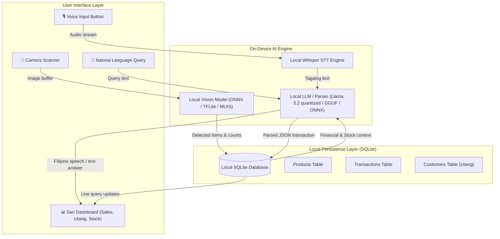
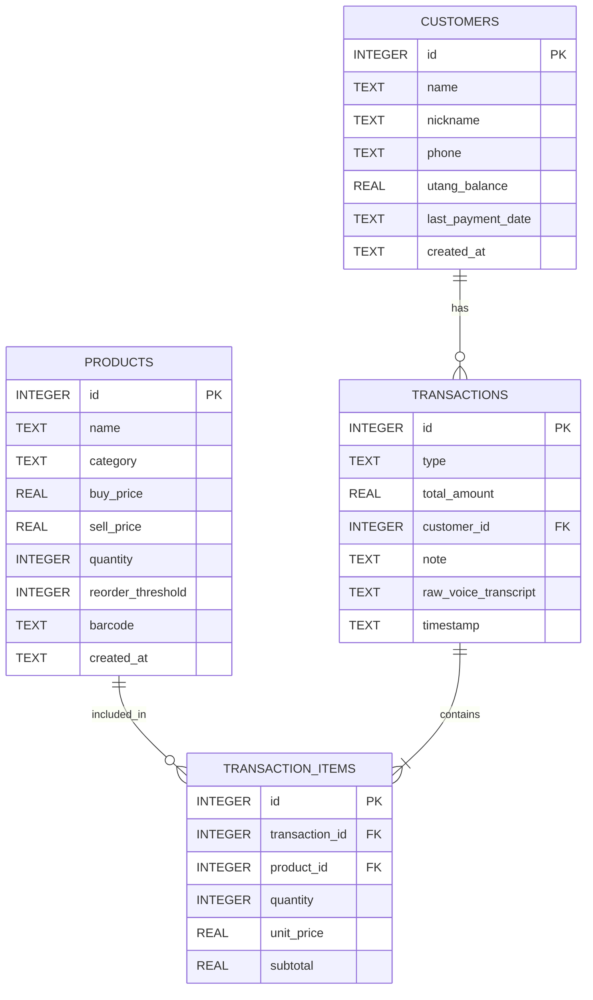

# System Design & Architecture — Sari

**Architecture Choice:** **Option B: Native Mobile Architecture (Android / Flutter)**  
**Target Hardware:** Budget to Mid-Range Android Phones (Android 8.0+, ARM64, 4GB+ RAM)  
**Offline Capability:** 100% On-Device Inference (Zero internet required)

---

## 1. High-Level System Architecture



---

## 2. Entity Relationship Diagram (ERD)



---

## 3. Database Schema (SQLite DDL)

```sql
-- 1. Customers Table (Utang Ledger)
CREATE TABLE IF NOT EXISTS customers (
    id INTEGER PRIMARY KEY AUTOINCREMENT,
    name TEXT NOT NULL,
    nickname TEXT,
    phone TEXT,
    utang_balance REAL NOT NULL DEFAULT 0.0,
    last_payment_date TEXT,
    created_at TEXT DEFAULT (datetime('now', 'localtime'))
);

-- 2. Products Table (Inventory)
CREATE TABLE IF NOT EXISTS products (
    id INTEGER PRIMARY KEY AUTOINCREMENT,
    name TEXT NOT NULL,
    category TEXT NOT NULL,
    buy_price REAL NOT NULL,
    sell_price REAL NOT NULL,
    quantity INTEGER NOT NULL DEFAULT 0,
    reorder_threshold INTEGER NOT NULL DEFAULT 5,
    barcode TEXT,
    created_at TEXT DEFAULT (datetime('now', 'localtime'))
);

-- 3. Transactions Table (Sales, Utang, Payments, Restocks)
CREATE TABLE IF NOT EXISTS transactions (
    id INTEGER PRIMARY KEY AUTOINCREMENT,
    type TEXT NOT NULL CHECK (type IN ('sale', 'utang', 'payment', 'restock')),
    total_amount REAL NOT NULL,
    customer_id INTEGER,
    note TEXT,
    raw_voice_transcript TEXT,
    timestamp TEXT DEFAULT (datetime('now', 'localtime')),
    FOREIGN KEY (customer_id) REFERENCES customers(id) ON DELETE SET NULL
);

-- 4. Transaction Items Table (Line Items)
CREATE TABLE IF NOT EXISTS transaction_items (
    id INTEGER PRIMARY KEY AUTOINCREMENT,
    transaction_id INTEGER NOT NULL,
    product_id INTEGER NOT NULL,
    quantity INTEGER NOT NULL,
    unit_price REAL NOT NULL,
    subtotal REAL NOT NULL,
    FOREIGN KEY (transaction_id) REFERENCES transactions(id) ON DELETE CASCADE,
    FOREIGN KEY (product_id) REFERENCES products(id) ON DELETE RESTRICT
);

-- Indexes for performance
CREATE INDEX IF NOT EXISTS idx_customers_utang ON customers(utang_balance);
CREATE INDEX IF NOT EXISTS idx_transactions_timestamp ON transactions(timestamp);
CREATE INDEX IF NOT EXISTS idx_products_quantity ON products(quantity);
```

---

## 4. Local AI Specifications & Sizing

| Component | Architecture / Engine | Target Size | Execution Mode | Target Latency |
|---|---|---|---|---|
| **Speech-to-Text (STT)** | Whisper Tiny / Small (quantized) | ~75MB - ~150MB | NDK / CPU+NEON / OpenCL | < 1.5 seconds |
| **Transaction NLP / LLM** | Llama 3.2 1B/3B (Q4_K_M) / On-device rule+regex parser fallback | ~700MB - ~1.8GB | llama.cpp / MLC / Native NDK | < 2.0 seconds |
| **Object Detection & Vision** | MobileNetV3 / YOLOv8n / Google MLKit | ~15MB - ~25MB | NNAPI / GPU / TFLite | < 100ms per frame |

### Resilience Strategy (Fast-Path Parser + LLM Fallback)
For the hackathon:
1. **Rule-Based Tagalog Transaction Parser (Instant / 0ms):** Handles standard patterns like *"Si [Name] utang [Amount] [Item]"* or *"Benta ko [Item] [Amount]"* using deterministic Tagalog regex & entity matching.
2. **Local LLM Invocations:** Handles conversational queries (*"Kumikita ba ako ngayong linggo?"*) and edge-case utterance parsing.
This ensures zero-latency demo guarantees even on low-RAM test phones.
